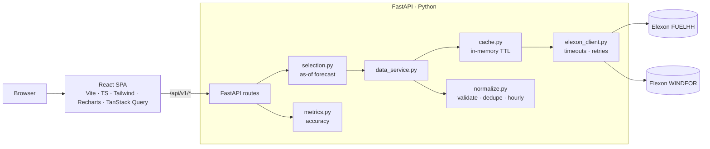

# GridBrick: GB Wind Forecast Decision Support

GridBrick is a web portal for a UK utility's **day-ahead power procurement team**. It answers two questions for January 2026:

1. **What wind forecast was actually available when the buy decision had to be made?** This is an as-of view with no look-ahead.
2. **How accurate was that forecast?** Errors are quantified so the desk can size a buffer against wind shortfall.

It uses only national-level Elexon BMRS data: **FUELHH** (actual generation, `fuelType = WIND`) and **WINDFOR** (wind generation forecasts, every published run).

> **Live app:** `<add Vercel URL>`
> **Scope note:** the portal analyses wind forecasts and their accuracy. It does **not** compute total procurement volume, because consumer demand data is outside the assessment scope.

---

## Contents
- [Key features](#key-features)
- [Business logic](#business-logic)
- [Architecture](#architecture)
- [Project structure](#project-structure)
- [Running locally](#running-locally)
- [Testing](#testing)
- [Deployment (Vercel)](#deployment-vercel)
- [API reference](#api-reference)
- [Assumptions, limitations and design decisions](#assumptions-limitations-and-design-decisions)
- [Data attribution](#data-attribution)
- [Use of AI tools](#use-of-ai-tools)

---

## Key features

| Page | What it shows |
|---|---|
| **Overview** | Coverage, MAE, RMSE, Bias, MAPE and WAPE KPIs. Plain-English procurement takeaways, including a P90 shortfall buffer and the worst day. A month-long actual-vs-forecast chart with zoom. |
| **Forecast vs Actual** | Pick a delivery day. The page shows the decision cutoff, the forecast run used and the forecast horizon. A chart plots the forecast with a **P10–P90 likely range** and the actual. Selecting an hour opens the **forecast evolution** panel: every WINDFOR run for that hour, with the run used highlighted and later runs marked "not used". A sortable hourly table with CSV export. |
| **Accuracy** | KPI cards with metric definitions, error by hour of day, error distribution, daily trend, a data quality and coverage report, and a full sortable, paginated table with CSV export. |

**Global filters** are stored in the URL, so every view is shareable:
- **January 2026 interpretation:** *Decisions in Jan* (default) or *Deliveries in Jan*.
- **Decision cutoff:** any HH:MM, with presets for 09:20, 09:50 and 10:00.
- **Delivery day range.**

Every view has loading, empty and error states, and errors can be retried. Data comes only from Elexon; nothing is fabricated or interpolated.

The UI uses a **green theme with light and dark modes**. The sun/moon toggle in the header remembers your choice; otherwise it follows the operating system setting. Colours are defined once as semantic tokens in `frontend/src/index.css`, and the charts read the same tokens through CSS variables.

### Headline results (decision-date scope, 10:00 cutoff)
| Metric | Value |
|---|---|
| Coverage | 744 / 744 hours (100%) |
| MAE / RMSE | 2,013 MW / 2,506 MW |
| Bias (F − A) | **+1,730 MW**: the forecast was systematically higher than metered wind |
| WAPE / MAPE | 17.8% / 21.6% |
| P90 shortfall | 4,144 MW: in 9 of 10 hours, wind fell short of the forecast by less than this |

These figures come from live Elexon data, checked on 30 Oct 2026. Moving the cutoff earlier (09:20, which selects the 07:30 run) raises MAE to about 2,039 MW, and a later cutoff lowers it. Fresher forecasts are more accurate.

---

## Business logic

### Three timestamps
| Name | Meaning |
|---|---|
| `startTime` | Delivery hour the value refers to |
| `publishTime` | When the forecast run was published |
| decision cutoff | When the desk commits its day-ahead bids |

### As-of forecast selection
This logic lives in [`backend/app/services/selection.py`](backend/app/services/selection.py). For each delivery hour *h* on delivery day *D*:

```
cutoff(D) = (D − 1 day) at HH:MM Europe/London, converted to UTC
selected  = WINDFOR row where startTime == h AND publishTime <= cutoff(D),
            choosing the greatest publishTime
```

- A forecast published after the cutoff is **never** used. This prevents look-ahead bias.
- If no run exists before the cutoff, the hour is marked **unavailable**. It never falls back to a later run.
- Selection is per hour, so it still works if a single run doesn't cover the whole day.

### Matching resolution: hourly
WINDFOR forecasts are **hourly**: every `startTime` in the January window falls on `:00`. FUELHH actuals are **half-hourly**. Each hour's actual is therefore the **mean of its two half-hours**. If one half-hour is missing, the hour is treated as missing rather than averaged from partial data. Matching at half-hourly resolution would leave every `:30` period without a forecast.

### Accuracy metrics
These live in [`backend/app/services/metrics.py`](backend/app/services/metrics.py). Error = **Forecast − Actual**. A positive error is an over-forecast, meaning less wind arrived than expected and the buyer would be short.

| Metric | Formula | Notes |
|---|---|---|
| MAE | mean(\|F − A\|) | Typical miss in MW |
| RMSE | √mean((F − A)²) | Penalises large misses |
| Bias | mean(F − A) | > 0 over-forecast, < 0 under-forecast |
| MAPE | mean(\|F − A\| / A) × 100 | Hours with A = 0 are excluded, and the count is reported. Inflated when wind is low |
| WAPE | Σ\|F − A\| / Σ\|A\| × 100 | Preferred % metric |
| P90 shortfall | 90th percentile of (F − A) | A practical buffer size |
| Coverage | matched / expected hours | Missing forecast and missing actual are reported separately |

Metrics use **valid forecast/actual pairs only**, with no interpolation or zero-filling.

**P10–P90 band:** for a delivery day, the likely range of the actual is `forecast − P90(error)` to `forecast − P10(error)`. The error percentiles come from the **same local hour on delivery days up to D-2 only**, whose outcomes were known at the decision cutoff, so the band never uses future information. It needs at least 5 such days. Its history may reach back before the selected scope (to 31 Dec), so bands start on 7 Jan. The page reports a back-test of how often the actual fell inside: **74.4%** for the default scope, against a nominal 80%.

### January 2026 interpretation
| Scope | Decision days | Delivery days |
|---|---|---|
| **Decisions in Jan** (default, matches the brief's wording) | 1–31 Jan 2026 | 2 Jan – 1 Feb 2026 |
| Deliveries in Jan | 31 Dec 2025 – 30 Jan 2026 | 1–31 Jan 2026 |

The two interpretations are never mixed. The active scope is always shown in the header.

---

## Architecture



**Request flow:**
1. A route parses and validates the query parameters.
2. `WindDataService` returns cached, normalised frames. On a cache miss it makes 2 Elexon calls, about 2 seconds in total.
3. `selection.build_comparison` picks the as-of forecast and joins it with actuals.
4. `metrics.*` computes the aggregates.
5. Pydantic models serialise the result.

**Design choices:**
- **Live data with a cache, no database.** The scope is one month, so the backend downloads the full window once, covering both interpretations: about 1.6k FUELHH rows and about 20k WINDFOR rows. It keeps them in memory with a configurable TTL. Changing the cutoff or scope only re-runs the in-memory selection, which takes about 20 ms.
- **Thin routes, pure services.** Business logic is plain pandas functions with no I/O, which makes it easy to unit-test.
- **Single origin.** In development, Vite proxies `/api` to FastAPI. In production, Vercel serves both, so the browser never needs CORS. All Elexon calls originate from the backend.
- **Resilience.** The HTTP client uses a 30 s timeout and up to 3 retries with exponential backoff on 429, 5xx and network errors. Other 4xx responses fail fast. Upstream failure returns **503** with a clear message, and the UI offers **Retry**.

---

## Project structure

```
.
├─ backend/
│  ├─ app/
│  │  ├─ main.py              # FastAPI app factory, CORS, 503 handler, router mounting
│  │  ├─ config.py            # Settings (env-driven), timezone, Elexon fetch windows
│  │  ├─ elexon_client.py     # HTTP client: FUELHH + WINDFOR, timeouts, retries
│  │  ├─ schemas.py           # Pydantic response models
│  │  ├─ routes/
│  │  │  ├─ deps.py           # Service wiring, shared query params, serialisation helper
│  │  │  ├─ meta.py           # /health, /meta
│  │  │  ├─ analytics.py      # /overview, /accuracy
│  │  │  └─ forecasts.py      # /forecasts, /forecasts/evolution
│  │  └─ services/
│  │     ├─ cache.py          # Thread-safe in-memory TTL cache
│  │     ├─ data_service.py   # Client + cache + normalisation
│  │     ├─ normalize.py      # WIND filter, UTC parsing, validation, dedupe, hourly mean
│  │     ├─ selection.py      # Scopes, cutoffs, DST-aware delivery hours, as-of selection
│  │     └─ metrics.py        # MAE, RMSE, Bias, MAPE, WAPE, coverage, by-hour, band…
│  ├─ tests/                  # pytest suite (no network)
│  ├─ requirements.txt / requirements-dev.txt / pytest.ini
│  └─ Dockerfile
├─ frontend/
│  ├─ src/
│  │  ├─ api/                 # fetch wrapper + typed endpoint functions
│  │  ├─ types/api.ts         # TS mirrors of the Pydantic schemas
│  │  ├─ hooks/               # useFilters (URL state), TanStack Query hooks
│  │  ├─ utils/               # UK-time formatting, number formatting, CSV export
│  │  ├─ components/
│  │  │  ├─ layout/           # AppShell (header, nav, footer), FilterBar
│  │  │  ├─ common/           # Card, KpiCard, loading/error/empty states, metric definitions
│  │  │  ├─ charts/           # Recharts components + shared theme
│  │  │  └─ tables/           # Sortable, paginated comparison table with CSV export
│  │  ├─ pages/               # OverviewPage, ForecastVsActualPage, AccuracyPage
│  │  ├─ App.tsx / main.tsx
│  ├─ vite.config.ts          # Tailwind plugin, /api dev proxy, vendor chunking
│  └─ Dockerfile
├─ api/index.py               # Vercel Python entry point (re-exports the FastAPI app)
├─ requirements.txt           # Python deps for Vercel
├─ vercel.json / .vercelignore / .python-version
├─ docker-compose.yml
├─ .env.example
├─ docs/DEMO_SCRIPT.md        # Two-part video script and checklist
├─ docs/ANALYSIS_AND_CUSTOMER_GUIDE.md  # Correctness review, independent verification, demo plan, procurement value
└─ docs/DEPLOYMENT.md        # Step-by-step Vercel deployment (frontend + backend, free plan)
```

---

## Running locally

> **Dependencies are not included in the repo or zip.** `frontend/node_modules` and `backend/.venv` are deliberately excluded, along with build output and caches. The steps below recreate them. A first-time setup takes about 2–5 minutes and needs internet access.

### Quick start (TL;DR)
```bash
# Option A – Docker
docker compose up --build                  # then open http://localhost:5173

# Option B – manual (two terminals)
cd backend  && python3 -m venv .venv && source .venv/bin/activate && pip install -r requirements-dev.txt && uvicorn app.main:app --port 8000
cd frontend && npm ci && npm run dev       # then open http://localhost:5173
```

### 1. Prerequisites

| Tool | Version | Needed for | Check with | Get it |
|---|---|---|---|---|
| **Python** | 3.12 or newer (tested on 3.12 and 3.14) | Option B (backend) | `python3 --version` (Windows: `py --version`) | <https://www.python.org/downloads/> or `brew install python@3.12` |
| **Node.js** + npm | Node 18 or newer, **22 LTS recommended** (tested on 22.0); npm 9+ | Option B (frontend) | `node --version`, `npm --version` | <https://nodejs.org/> (LTS) or `brew install node@22` / `nvm install 22` |
| **Docker Desktop** (Compose v2) | Any recent version | Option A only | `docker --version`, `docker compose version` | <https://www.docker.com/products/docker-desktop/> |
| Internet access | Must reach `data.elexon.co.uk`, plus PyPI and the npm registry during install | Both | `curl -I https://data.elexon.co.uk/bmrs/api/v1/datasets/FUELHH/stream` | — |

- **Ports:** the app uses **8000** (backend API) and **5173** (frontend). Make sure they're free, or see Troubleshooting.
- **`.python-version`:** the repo root has a `.python-version` file (`3.12`) for Vercel. If you use **pyenv** or **uv**, they may try to switch to 3.12 inside the folder. Either install it (`pyenv install 3.12`) or create the venv with an explicit interpreter, e.g. `python3.13 -m venv .venv`.

### 2. Unpack the project
```bash
unzip gridbrick.zip -d ~/projects        # or extract with your OS file manager
cd ~/projects/gridbrick
```
Everything below runs from this project root unless a step says otherwise.

### Option A: Docker Compose (simplest, no Python or Node needed)
```bash
cp .env.example .env              # optional – the defaults work without it
docker compose up --build         # first build takes ~2–4 min (downloads base images + dependencies)
```
When the logs show `Uvicorn running on http://0.0.0.0:8000` and Vite's `Local: http://localhost:5173/`:

| Open | What you should see |
|---|---|
| <http://localhost:5173> | The GridBrick UI |
| <http://localhost:8000/api/v1/health> | `{"status":"ok"}` |
| <http://localhost:8000/api/v1/docs> | Interactive API documentation (Swagger) |

Useful commands:
```bash
docker compose logs -f backend    # follow backend logs (Elexon requests, errors)
docker compose ps                 # container status (backend should be "healthy")
docker compose down               # stop and remove containers
docker compose up --build         # rebuild after changing code or dependencies
```
The frontend container runs Vite's dev server and proxies `/api` to the `backend` container, so the browser only talks to port 5173.

### Option B: Manual setup (Python + Node)

**Step 1: Backend (terminal 1)**

macOS / Linux:
```bash
cd backend
python3 -m venv .venv                     # creates backend/.venv
source .venv/bin/activate                 # prompt now starts with (.venv)
python -m pip install --upgrade pip
pip install -r requirements-dev.txt       # app deps + pytest (~1–2 min)
uvicorn app.main:app --reload --port 8000
```

Windows (PowerShell):
```powershell
cd backend
py -3.12 -m venv .venv                    # or: python -m venv .venv
.\.venv\Scripts\Activate.ps1              # if blocked: Set-ExecutionPolicy -Scope CurrentUser RemoteSigned
python -m pip install --upgrade pip
pip install -r requirements-dev.txt
uvicorn app.main:app --reload --port 8000
```

Windows (Command Prompt): use `.venv\Scripts\activate.bat` instead of `Activate.ps1`.

**Step 2: Check the backend works** (in another terminal or a browser):
```bash
curl http://localhost:8000/api/v1/health          # {"status":"ok"}
curl "http://localhost:8000/api/v1/overview" | head -c 200   # first call ~2–3 s (downloads Elexon data)
```
Or open <http://localhost:8000/api/v1/docs>.

**Step 3: Frontend (terminal 2)**
```bash
cd frontend
npm ci              # exact versions from package-lock.json (~30–60 s); use `npm install` if npm ci complains
npm run dev         # Vite dev server on http://localhost:5173
```
The dev server proxies `/api/*` to `http://localhost:8000`, so you don't need any CORS or URL configuration.

**Step 4: Open <http://localhost:5173>**

The first page load downloads January's data from Elexon, which takes a few seconds. After that, interactions are served from the in-memory cache in about 20–50 ms.

**Stopping and restarting:**
- Stop either server with `Ctrl+C`.
- Next time you don't need to reinstall anything. Start the backend with `cd backend && source .venv/bin/activate && uvicorn app.main:app --port 8000` (on Windows, activate with `.\.venv\Scripts\Activate.ps1`). Start the frontend with `cd frontend && npm run dev`.

**Optional: production build of the frontend**
```bash
cd frontend
npm run build       # type-check (tsc) + Vite build -> frontend/dist
npm run preview     # serve the built files on http://localhost:4173 (proxies /api to the backend like dev mode)
```
`npm run dev` is still the usual way to run locally: it reloads instantly as you edit.

### 3. Check that everything works
- [ ] The Overview shows **Coverage 100%** and **MAE ≈ 2,013 MW**, with the default *Decisions in Jan* scope and a 10:00 cutoff.
- [ ] On **Forecast vs Actual**, picking *Wed 28 Jan* and clicking the 17:00 hour shows the forecast evolution chart.
- [ ] Clicking cutoff preset **09:20** changes "Forecast run used" from 09:30 to 07:30.
- [ ] The **Accuracy** page shows three charts and a paginated table; **Export CSV** downloads a file.
- [ ] The sun/moon icon switches between light and dark mode.
- [ ] `cd backend && pytest -q` shows **44 passed** (see [Testing](#testing)).

### 4. Configuration
None of these are required. To override the defaults:
- **Manual setup:** create `backend/.env`, or export the variables in the backend terminal.
- **Docker:** create `.env` in the project root (copy `.env.example`). Compose passes it to the backend.

| Variable | Default | Purpose |
|---|---|---|
| `ELEXON_BASE_URL` | `https://data.elexon.co.uk/bmrs/api/v1` | Elexon API base |
| `HTTP_TIMEOUT_S` | `30` | Per-request timeout |
| `HTTP_MAX_RETRIES` | `3` | Retries on 429, 5xx and network errors |
| `CACHE_TTL_S` | `3600` | Cache lifetime |
| `CORS_ORIGINS` | `http://localhost:5173` | Only needed if the UI is served from another origin |
| `VITE_PROXY_TARGET` (frontend) | `http://localhost:8000` | Where the Vite dev server proxies `/api`. Docker sets it to `http://backend:8000` |

No secrets are needed, because the Elexon BMRS API is public.

### 5. Troubleshooting

| Problem | Fix |
|---|---|
| `python3: command not found` / wrong version | Install Python 3.12+. On Windows, use `py -3.12`. Check with `python --version` *after* activating the venv |
| `pip install` fails while building pandas or numpy | Usually an old Python or pip. Upgrade pip (`python -m pip install --upgrade pip`) and use Python 3.12+, which has prebuilt wheels |
| PowerShell: "running scripts is disabled" | `Set-ExecutionPolicy -Scope CurrentUser RemoteSigned`, then activate again |
| `npm ci` errors about the lock file or Node version | Use Node 22 LTS. As a fallback run `npm install` |
| `Error: listen EADDRINUSE :5173` / `address already in use :8000` | Another process is using the port. Find it with `lsof -i :8000` (macOS/Linux) or `netstat -ano \| findstr 8000` (Windows), or run on other ports: `uvicorn app.main:app --port 8001` with `VITE_PROXY_TARGET=http://localhost:8001 npm run dev` |
| UI says **"Cannot reach the GridBrick API. Is the backend running?"** | Start the backend (Step 1) and make sure it's on port 8000 (or set `VITE_PROXY_TARGET`) |
| UI says **"Elexon data is temporarily unavailable"** (HTTP 503) | The backend can't reach `data.elexon.co.uk`. Check your internet connection or VPN. Behind a corporate proxy, set `HTTPS_PROXY=http://proxy:port` in the backend terminal before starting uvicorn; httpx honours it. Then click **Retry** |
| Docker: `docker-compose: command not found` | Use Compose v2 syntax: `docker compose` (with a space) |
| Docker: frontend starts before the backend is ready | It waits for the backend health check automatically. Give it about 10 s, or check `docker compose ps` |
| Changes to `.env` aren't picked up | Restart uvicorn, or run `docker compose up` again |

### 6. Before zipping or transferring the folder
Remove installed dependencies and generated files. They're large (about 380 MB) and specific to each machine:
```bash
rm -rf frontend/node_modules frontend/dist backend/.venv
find . \( -name "__pycache__" -o -name ".pytest_cache" -o -name ".DS_Store" \) -prune -exec rm -rf {} +
cd .. && zip -r gridbrick.zip gridbrick -x "*/node_modules/*" "*/.venv/*" "*/.env"
```
Keep `frontend/package-lock.json`: it pins the exact frontend dependency versions.

---

## Testing

```bash
cd backend
source .venv/bin/activate          # Windows: .\.venv\Scripts\Activate.ps1
pytest -q                          # 44 tests, no network access needed
pytest -v tests/test_selection.py  # e.g. just the look-ahead / selection tests
```

| File | Covers |
|---|---|
| `test_selection.py` | **Runs published after the cutoff are excluded**. A run published exactly at the cutoff is eligible. The latest eligible run is chosen. No eligible run means unavailable, not a later run. Per-hour selection. Matching by `startTime` and status flags. Decision vs delivery scopes. DST-aware cutoffs and 23/25-hour days. Forecast evolution flags. |
| `test_metrics.py` | MAE, RMSE and Bias on hand-computed data. Negative bias. MAPE with zero actuals and the excluded count. WAPE. Missing records and coverage. Empty input returns None, not 0. By-hour buckets. Histogram. Band uses only days ≤ D-2, needs enough history, and its coverage back-test. |
| `test_normalize.py` | WIND-only filter. Invalid rows dropped, not zeroed. Duplicates keep the latest publish. Half-hour to hourly averaging, with incomplete hours marked missing. UTC to Europe/London conversion. Every forecast vintage kept. |
| `test_elexon_client.py` | A mocked transport checks query parameters, response parsing, retry or backoff on 5xx, giving up, no retry on 4xx, and network errors. |
| `test_api.py` | Route smoke tests with a fake client: the cutoff changes which run is used, 404, 422 and 503 paths, and the evolution endpoint. |

To type-check and build the frontend: `cd frontend && npm run build`.

---

## Deployment (Vercel)

📄 **Step-by-step guide:** [`docs/DEPLOYMENT.md`](docs/DEPLOYMENT.md), covering free-plan limits, setup, verification and troubleshooting.

A single Vercel project on the free Hobby plan serves both parts:
- The **React build** is a static site (`frontend/dist`).
- **`api/index.py`** runs as a Python serverless function exposing the FastAPI app. `vercel.json` rewrites `/api/*` to it, and every other path to `index.html` so client-side routes work.

Steps:
1. Import the GitHub repo into Vercel with the root directory set to the repo root. Vercel picks up the settings from `vercel.json`.
2. Deploy. You can optionally set the environment variables from the table above.
3. Check `https://<app>.vercel.app/api/v1/health` and the UI.

**Trade-off:** the in-memory cache lives per serverless instance, so the first request after a cold start re-downloads from Elexon (about 2–3 s). Production would use scheduled ingestion into a small database or object store.

---

## API reference

Interactive docs are at `/api/v1/docs`. Common query parameters are `scope=decision|delivery`, `cutoff=HH:MM` (UK time on D-1, default `10:00`), and `from` / `to` (delivery days).

| Endpoint | Returns |
|---|---|
| `GET /api/v1/health` | `{"status":"ok"}` |
| `GET /api/v1/meta` | Scope description, delivery days, data sources, assumptions |
| `GET /api/v1/overview` | KPIs, hourly forecast/actual series, daily summary |
| `GET /api/v1/forecasts?date=YYYY-MM-DD` | One day's hourly rows with the P10–P90 band, cutoff and runs used. Without `date`, all rows in scope |
| `GET /api/v1/forecasts/evolution?start_time=ISO&cutoff=HH:MM` | Every run for one delivery hour, flagged selected or after-cutoff, plus the actual |
| `GET /api/v1/accuracy` | KPIs, by-hour stats, daily trend, error histogram, data quality counts |

Status codes:
- `422`: invalid parameters
- `404`: date outside scope
- `503`: Elexon unavailable after retries

---

## Assumptions, limitations and design decisions

**Assumptions:**
- **Decision cutoff.** The brief gives no decision time. The default is **10:00 Europe/London on D-1**, chosen as an illustrative value and configurable in the UI. For reference, the GB day-ahead auctions close at **09:20** (EPEX 60-min) and **09:50** (N2EX, Nord Pool). WINDFOR runs are published at about 02:30, 04:30, 07:30, 09:30, 11:30, 15:30, 18:30 and 22:30 UTC, so a 09:20 cutoff uses the 07:30 run while 09:50 or 10:00 use the 09:30 run.
- **Delivery day.** A delivery day runs from 00:00 to 24:00 UK time. Timestamps are stored in UTC and displayed in Europe/London. January has no DST change, but the logic is DST-aware and tested.

**Limitations:**
- **Interpreting the bias.** Over-forecasting of about 1.7 GW on average is a real feature of this data. One plausible contributor is that metered output can be reduced by curtailment or constraint actions that a weather-driven forecast does not anticipate. Checking this needs data outside this pilot's scope.
- **The band is an empirical summary of past errors, not a calibrated probabilistic forecast.** Each percentile comes from only 5–30 points per hour. In the back-test it captured 74% of actuals, against a nominal 80%, so it is somewhat too narrow.
- **Single month, single region.** The same pipeline would extend to longer histories (with chunked fetching and persistent storage), solar, or demand-net-of-renewables.

**Design decisions:**
- **Deviations from the original build prompt** (all intentional):

  | Original prompt | This build | Reason |
  |---|---|---|
  | Half-hourly matching | Hourly matching | WINDFOR is hourly |
  | Error by settlement period | Error by hour of day | Same reason |
  | Four pages | Three pages; evolution sits next to the day chart | Less navigation; evolution belongs beside the chart it explains |
  | Frontend tests | None; backend tests only | The risk sits in the backend logic |
  | Separate backend host | One Vercel project | Free, one URL, and no CORS needed in production |

---

## Data attribution
Data is from Elexon BMRS:
- [FUELHH](https://bmrs.elexon.co.uk/api-documentation/endpoint/datasets/FUELHH/stream): generation outturn by fuel type
- [WINDFOR](https://bmrs.elexon.co.uk/api-documentation/endpoint/datasets/WINDFOR/stream): wind generation forecast

It is accessed through the public Insights Solution API at `data.elexon.co.uk` and is subject to Elexon's data licence terms.

## Use of AI tools
This project was developed with the help of an AI coding assistant (GitHub Copilot) for:
- planning and architecture discussion
- verifying the Elexon API behaviour
- code generation for the backend, frontend and tests
- documentation

All design decisions were reviewed and chosen by the author. The code was validated with the automated test suite, a type-checked production build, and manual checks against live Elexon data.
